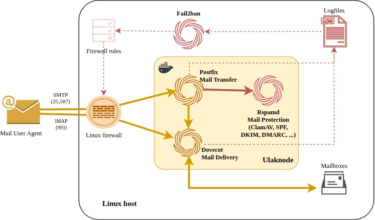

# ulaknode — self-hosted mail server

**Postfix + Dovecot + OpenDKIM/OpenDMARC + SpamAssassin — a complete business mail stack in a single Docker container.**

Deploy on any Linux server or VPS. No cloud dependency. No per-seat fees. Your data stays on your infrastructure.

---

## What's included

| Component | Role |
|---|---|
| **Postfix** | SMTP — sends and receives email |
| **Dovecot** | IMAP — mailbox access from any mail client |
| **OpenDKIM / OpenDMARC** | DKIM signing & verification, DMARC enforcement |
| **policyd-spf** | SPF checking |
| **Postgrey** | Greylisting |
| **SpamAssassin** | Content-based spam scoring |
| **Postscreen + Unbound** | DNSBL blocklist checking (Spamhaus, SpamCop) via a dedicated recursive resolver |
| **Fail2ban** | Bans brute-force SMTP/IMAP clients at the application layer |

---

## Quick start

### Prerequisites

- Linux server (Debian 12 or Ubuntu 22.04+ recommended)
- 2 vCPU, 4 GB RAM, 40 GB disk minimum
- Docker installed — `curl -fsSL https://get.docker.com | sh`
- A domain name with DNS management access
- A TLS certificate for your mail hostname (Let's Encrypt works)

### Deploy

Replace `mail.yourdomain.com` with your actual mail hostname, then run:

```bash
docker run -d \
  --name ulaknode \
  --hostname mail.yourdomain.com \
  --restart unless-stopped \
  -e MAIL_HOSTNAME=mail.yourdomain.com \
  -p 25:25 -p 587:587 -p 993:993 \
  -v ulak_mail:/var/mail \
  -v ulak_logs:/var/log \
  -v ulak_postfix:/etc/postfix \
  -v ulak_dovecot:/etc/dovecot \
  -v ulak_opendkim:/etc/opendkim \
  -v ulak_opendmarc:/etc/opendmarc \
  -v ulak_spamassassin:/etc/spamassassin \
  -v ulak_policyd_spf:/etc/postfix-policyd-spf-python \
  -v ulak_postgrey:/etc/postgrey \
  -v ulak_fail2ban:/etc/fail2ban \
  -v ulak_unbound:/etc/unbound \
  -v ulak_certs:/etc/ssl/mail \
  -v /etc/letsencrypt/live/mail.yourdomain.com/fullchain.pem:/run/certs/fullchain.pem:ro \
  -v /etc/letsencrypt/live/mail.yourdomain.com/privkey.pem:/run/certs/privkey.pem:ro \
  ghcr.io/itefix/ulaknode:latest
```

Named volumes are created automatically on first run.

---

## Managing domains and mailboxes

```bash
# Add a domain
docker exec ulaknode ulaknode-domain add yourdomain.com

# Add a mailbox
docker exec ulaknode ulaknode-mailbox add alice@yourdomain.com secretpassword

# Add an alias
docker exec ulaknode ulaknode-alias add info@yourdomain.com alice@yourdomain.com

# Set a quota
docker exec ulaknode ulaknode-mailbox quota-set alice@yourdomain.com 5G

# List mailboxes
docker exec ulaknode ulaknode-mailbox list yourdomain.com
```

## Email security (DKIM, SPF, DMARC)

```bash
# Generate DKIM key — prints the DNS TXT record to publish
docker exec ulaknode ulaknode-dkim generate yourdomain.com

# Generate SPF record
docker exec ulaknode ulaknode-spf generate yourdomain.com --mx

# Generate DMARC record
docker exec ulaknode ulaknode-dmarc generate yourdomain.com \
  --policy none --rua mailto:postmaster@yourdomain.com
```

---

## Ports

| Port | Purpose |
|---|---|
| 25 | SMTP — inbound mail |
| 587 | Submission — outbound mail from clients |
| 993 | IMAPS — mailbox access (TLS) |

---

## Full deployment guide

See [docs/self-hosted.md](docs/self-hosted.md) for the complete setup walkthrough including DNS, firewall, DNSBL, and TLS.

Brute-force protection (Fail2ban) has its own guide: [docs/fail2ban.md](docs/fail2ban.md).

See [CHANGELOG.md](CHANGELOG.md) for release history.

---

## Support

ulaknode is free software provided as-is, with no support or SLA. Issues and pull requests are welcome and handled on a best-effort basis. For security problems see [SECURITY.md](SECURITY.md).

---

## License

BSD 2-Clause — see [LICENSE](LICENSE).
